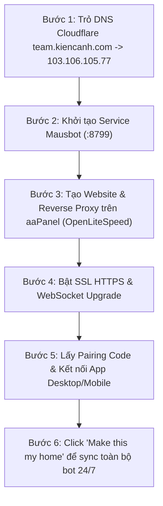

# Kế Hoạch Triển Khai Mausbot Cho Subdomain team.kiencanh.com Trên VPS aaPanel (103.106.105.77)

> **Mục tiêu:** Cài đặt hệ thống **Mausbot** (OpenMausbot) hoạt động 24/7 trên VPS `103.106.105.77`, truy cập qua subdomain `https://team.kiencanh.com`, đồng bộ hai chiều (2-way sync) với ứng dụng Desktop/Mobile qua tính năng "Make my home", **an toàn tuyệt đối và không gây xung đột** với OpenLiteSpeed, PBN Dashboard V2 và các website WordPress hiện hữu.

---

## 1. Trả Lời: Có Cần Thiết Dùng Docker Không?

### 1.1. Có bắt buộc dùng Docker không?
👉 **KHÔNG BẮT BUỘC 100%.**
* **Hiện trạng VPS 103.106.105.77:** Đã có sẵn Node.js **v25.9.0** (vượt chuẩn yêu cầu tối thiểu Node >= 24 của OpenMausbot) và có sẵn **PM2**.
* Hoàn toàn có thể cài trực tiếp bằng lệnh `npm install -g openmausbot` và quản lý tiến trình bằng **PM2** (chạy ngầm tương tự như `pbn-v2` và `hermes-web` đang có).

### 1.2. Tại sao VẪN RẤT KHUYẾN NGHỊ NÊN DÙNG DOCKER?
Mặc dù chạy trực tiếp bằng PM2 được, việc dùng Docker mang lại 3 lợi ích cốt tử cho hệ thống server này:

1. **Bảo mật & Cô lập (Sandbox Isolation):**
   * Mausbot là nền tảng AI Agent có khả năng tự động thực thi script, chạy lệnh shell, cài đặt thêm các CLI tool và chạy trình duyệt headless (Puppeteer/Chrome).
   * Nếu chạy trực tiếp ngoài host với quyền `root`, nếu bot gặp lỗi, script lạ hoặc bị prompt injection, nó có thể vô tình xóa hoặc sửa file của **PBN Dashboard V2, database MySQL và 1,221 site WordPress** đang chạy trên VPS.
   * Khi chạy Docker: Bot bị "nhốt" hoàn toàn trong container, chỉ được phép đọc/ghi trong thư mục riêng `/www/server/mausbot/data`.
2. **Kiểm soát RAM và tài nguyên (Resource Limits):**
   * Khi bot chạy headless browser, nó dễ ăn nhiều bộ nhớ chia sẻ. Docker cho phép cố định `shm_size: 512m` và giới hạn RAM, không để bot nuốt trọn RAM làm nghẽn OpenLiteSpeed và MySQL của PBN.
3. **Cập nhật & Dọn dẹp sạch sẽ:**
   * Khi có bản update mới, Docker chỉ cần 1 lệnh `docker compose pull` là xong, không làm rác môi trường Node.js toàn cục của server.

---

## 2. So Sánh 2 Phương Án Triển Khai Cho Subdomain `team.kiencanh.com`

| Hạng mục | Phương án 1A: Dùng Docker (Khuyên dùng) | Phương án 1B: Dùng PM2 (Không dùng Docker) |
| :--- | :--- | :--- |
| **Cách chạy** | Image `ghcr.io/milind-soni/openmausbot:latest` qua Docker Compose | `npm install -g openmausbot` qua PM2 daemon |
| **Port nội bộ** | `127.0.0.1:8799` | `127.0.0.1:8799` |
| **Reverse Proxy** | aaPanel OpenLiteSpeed (hỗ trợ WebSocket) | aaPanel OpenLiteSpeed (hỗ trợ WebSocket) |
| **Mức độ an toàn cho PBN** | **Rất cao (Cách ly Sandbox 100%)** | Trung bình (Chạy chung quyền root trên OS) |
| **Quản lý tiến trình** | `docker compose up / ps / restart` | `pm2 start / list / restart mausbot` |
| **Tài nguyên tiêu tốn** | Tốn thêm ~50MB RAM cho Docker container | Cực nhẹ, dùng trực tiếp Node.js host |

---

## 3. Quy Trình Triển Khai Chi Tiết (Từng Bước)



### Bước 1: Trỏ DNS cho `team.kiencanh.com`
* Đăng nhập vào Cloudflare quản lý tên miền `kiencanh.com`:
  * **Type:** `A`
  * **Name:** `team`
  * **Content (IPv4):** `103.106.105.77`
  * **Proxy status:** Bật `Proxied` (Đám mây cam) để kích hoạt SSL Cloudflare và chống DDoS.

### Bước 2: Thiết Lập Service Mausbot Lắng Nghe Nội Bộ (`127.0.0.1:8799`)
* **Nếu chọn Docker (1A):**
  Tạo thư mục `/www/server/mausbot` với file `docker-compose.yml`:
  ```yaml
  version: '3.8'
  services:
    omb:
      image: ghcr.io/milind-soni/openmausbot:latest
      container_name: mausbot-omb
      restart: unless-stopped
      init: true
      shm_size: 512m
      environment:
        - OMB_PORT=8799
        - OMB_SERVER_NAME=Mausbot-Kiencanh
        - OMB_PUBLIC_URL=https://team.kiencanh.com
        - OMB_SIGNIN_EMAILS=${ADMIN_EMAIL}
      ports:
        - "127.0.0.1:8799:8799"
      volumes:
        - ./data:/data
  ```
  Chạy lệnh: `cd /www/server/mausbot && docker compose up -d`.

* **Nếu chọn PM2 không Docker (1B):**
  ```bash
  npm install -g openmausbot
  mkdir -p /www/server/mausbot/data
  cd /www/server/mausbot
  pm2 start "openmausbot serve --port 8799 --public-url https://team.kiencanh.com" --name mausbot
  pm2 save
  ```

### Bước 3: Tạo Website & Reverse Proxy Trên aaPanel (OpenLiteSpeed)
1. Trong aaPanel → Mục **Website** → Thêm website mới:
   * Domain: `team.kiencanh.com`
   * PHP Version: Pure (không cần PHP runtime).
2. Mở cấu hình site `team.kiencanh.com` → Tab **Reverse Proxy**:
   * **Proxy Name:** `mausbot_proxy`
   * **Target URL:** `http://127.0.0.1:8799`
   * **Sent Domain:** `$host`
3. Cấu hình **WebSocket Rewrite** trong OpenLiteSpeed vhost config:
   ```apache
   RewriteEngine On
   RewriteCond %{HTTP:Upgrade} =websocket [NC]
   RewriteRule /(.*) ws://127.0.0.1:8799/$1 [P,L]
   RewriteCond %{HTTP:Upgrade} !=websocket [NC]
   RewriteRule /(.*) http://127.0.0.1:8799/$1 [P,L]
   ```

### Bước 4: Thiết Lập SSL
* Vì `kiencanh.com` chạy qua Cloudflare Proxy (đám mây cam), ta có thể chọn:
  * Cài SSL Let's Encrypt trực tiếp trên aaPanel (chế độ Full Strict).
  * Hoặc dùng Cloudflare Origin Certificate / SSL Flexible (nhanh chóng, tự động nhận HTTPS).

### Bước 5: Ghép Nối (Pairing) Với Ứng Dụng Desktop / Điện Thoại
1. Lấy mã Pairing:
   * Nếu dùng Docker: `docker exec -it mausbot-omb openmausbot pair`
   * Nếu dùng PM2: `openmausbot pair`
   Lệnh sẽ xuất ra mã 12 ký tự và đường link:
   `https://team.kiencanh.com/pair#code=XXXX-XXXX-XXXX`
2. Mở ứng dụng **MausBot Desktop** trên máy tính:
   * Nhấn dấu `＋` → Chọn **Connect to a server**.
   * Dán URL pairing vừa lấy được vào.
3. Khi kết nối thành công:
   * Nhấp chuột trái vào workspace server `team.kiencanh.com` → Chọn **"Make this my home"**.
   * Toàn bộ bot, memory và cấu hình từ máy local của bạn sẽ lập tức sync lên server và chạy online 24/7.

---

## 4. Xác Nhận Lần Cuối Để Thực Hiện

Bạn xem qua kế hoạch trên và chỉ cần chốt 2 điểm:
1. Bạn chọn **Phương án 1A (Dùng Docker - Khuyên dùng để cách ly an toàn cho PBN)** hay **Phương án 1B (Dùng PM2 trực tiếp - Không dùng Docker)**?
2. Bản ghi DNS Cloudflare `team.kiencanh.com` trỏ về `103.106.105.77` bạn đã thêm chưa, hay cần tôi hỗ trợ kiểm tra/thêm qua API Cloudflare?
